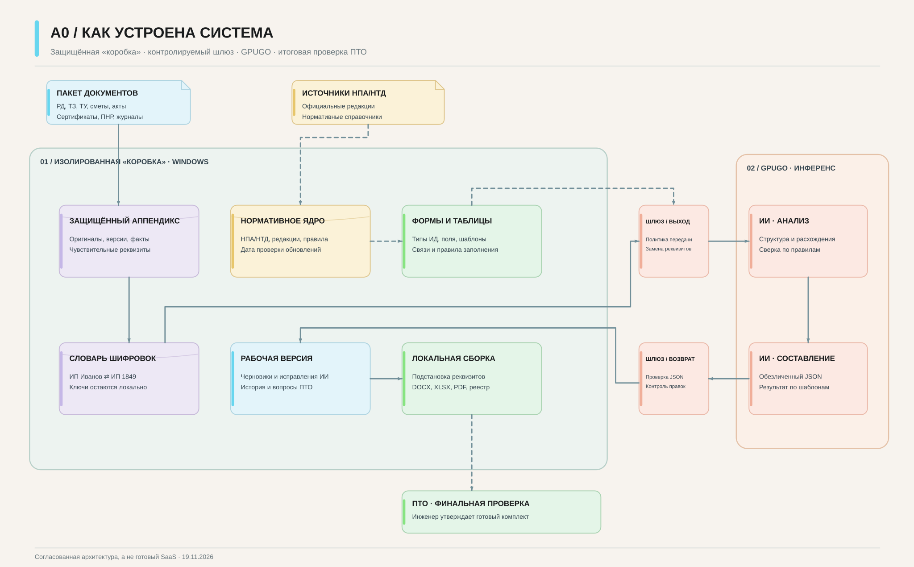

# Construction Docs · GPUGO

**Windows-приложение для подготовки, сверки и комплектования исполнительной документации с локальным защищённым контуром и AI-инференсом на серверах GPUGO.**

> **18.11.2026 · Architecture baseline**  
> Согласована функциональная модель. Работающий код пока является **инженерным PoC**, а не готовым SaaS, сертифицированной системой обработки персональных данных или подписания ИД.  
> **Статус:** [PR #1](https://github.com/jetsedpack/construction-docs-saas/pull/1) объединён с `main` 18.11.2026. Текущая ветка `main` содержит архитектурный baseline и ранний PoC.  
> **Проверки на момент слияния:** [GitHub Actions #128](https://github.com/jetsedpack/construction-docs-saas/actions/runs/44353780486) — успешно: Python-тесты на Linux/Windows, Windows UI import smoke, проверки архитектурных контрактов. Это не проверка production-развёртывания.

## Архитектура, которую можно открыть и показать

[**Визуальный атлас — четыре SVG-схемы + многостраничный draw.io**](diagrams/atlas/README.md) · [**Редактируемый исходник draw.io**](diagrams/atlas/architecture.drawio)

**Ключевая идея:** «коробка» существует **до импорта**, внутри неё живут правила, шаблоны, нормативная база, исходники и рабочие версии. Исходные чувствительные документы сначала поступают в закрытый аппендикс; ИИ взаимодействует с ними **только через контролируемый шлюз**.

| Лист | Что показываем | Превью |
| --- | --- | --- |
| **A0** | Границы коробки, GPUGO, ПТО и нормативного контура | [SVG](diagrams/atlas/a0-system.svg) |
| **F01** | Весь пакет за раз, но **тип каждого файла инженер выбирает отдельно** | [SVG](diagrams/atlas/f01-intake.svg) |
| **F04→F06** | Структурная копия → ИИ → обезличенный результат → **локальная подстановка реквизитов** | [SVG](diagrams/atlas/f04-f06-roundtrip.svg) |
| **F07** | Актуализация НПА/НТД и дата последнего подтверждённого обновления | [SVG](diagrams/atlas/f07-norms.svg) |

Статус **согласовано** означает продуктовую модель, **не означает «уже написано»**. Все четыре SVG — готовые векторные представления схем; узлы редактируются в `architecture.drawio`. [Старые схемы](diagrams/) сохранены как история исследования, но **не должны переопределять атлас**.

## Что именно утверждено 18 ноября

**[14 продуктовых решений](docs/decisions/2026-11-18-product-contract.md)** закрепляют последовательность:

`Папка РД → защищённое хранилище → выбор типа отдельно для каждого файла → парсер по типу → структурная копия (поля, связи, расположение, безопасные метаданные) → псевдонимы → GPUGO AI → обезличенный подготовленный документ → проверка шлюза → промежуточная версия → локальная подстановка реальных реквизитов → renderer DOCX/XLSX/PDF → ПТО утверждает финальный комплект.`

Нормативная база — внутри коробки; AI-обновления идут через контролируемый контур и версионируются. Во время обработки инженер может спрашивать ИИ на естественном языке; **не обязан принимать каждый промежуточный AI-шаг**. Неизвестный или непроверенный документ нельзя молча считать обработанным.

### Что можно реализовать по конкретным контрактам

## Файлы

| Подсистема | Фактическое состояние на 18.11.2026 |
| --- | --- |
| [diagrams/01-construction-data-flow.drawio](diagrams/01-construction-data-flow.drawio) | Основная красивая редактируемая схема |
| [diagrams/02-id-record-model.drawio](diagrams/02-id-record-model.drawio) | Табличная модель в пяти взаимосвязанных блоках |
| [docs/architecture.md](docs/architecture.md) | Подробное объяснение идеи и потоков данных |
| [docs/data-model.md](docs/data-model.md) | Виды таблиц, связи, поля, пример реестра |
| [diagrams/02-linked-records.mmd](diagrams/02-linked-records.mmd) | Схема связей между документами и данными |
| [diagrams/system-context.mmd](diagrams/system-context.mmd) | Компактная архитектурная схема |
| [diagrams/document-flow.mmd](diagrams/document-flow.mmd) | Цикл обработки замечаний и выпуска ИД |
| [docs/security-boundaries.md](docs/security-boundaries.md) | Границы доступа, шифрование, псевдонимизация |
| [docs/regulatory-sources.md](docs/regulatory-sources.md) | Отправные нормативные ориентиры и источники |
| [docs/decisions.md](docs/decisions.md) | Открытые архитектурные вопросы |
| [docs/roadmap.md](docs/roadmap.md) | Исследовательские шаги, не план обязательной разработки |
| [CONTRIBUTING.md](CONTRIBUTING.md) | Работа с Git и диаграммами |

**Следующий материал:** реальные (по возможности обезличенные) примеры таблиц, актов и структуры папок на облачных дисках для восстановления предметной модели.
