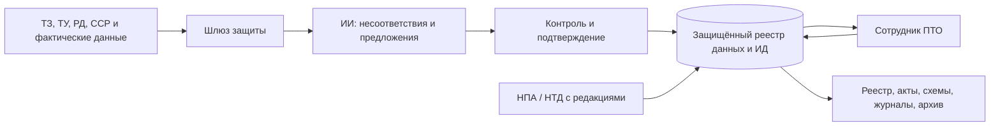

# Construction Docs SaaS

**Проект концепции SaaS для систематизации и контроля исполнительной документации (ИД) в строительстве.**

> 18 ноября 2026 · версия концепции 0.2 · исследование, не утверждённое техническое задание.

## Визуальная схема

**[Редактируемая схема draw.io: потоки, нормативы, ИИ, защищённая «коробка», ПТО](diagrams/01-construction-data-flow.drawio)**

Откройте файл на GitHub через [diagrams.net](https://app.diagrams.net/?mode=github) или скачайте и откройте в diagrams.net. Диаграмма собрана из редактируемых фигур и стрелок, а не является изображением.

## Ключевая идея

ИИ не считается источником подтверждённых фактов. Сведения, сметные планы, исполнение, документы контроля и предложения ИИ различаются; ПТО подтверждает результаты.

## Файлы

| Файл | Содержание |
| --- | --- |
| [diagrams/01-construction-data-flow.drawio](diagrams/01-construction-data-flow.drawio) | Основная красивая редактируемая схема |
| [docs/architecture.md](docs/architecture.md) | Подробное объяснение идеи и потоков данных |
| [docs/data-model.md](docs/data-model.md) | Виды таблиц, связи, поля, пример реестра |
| [diagrams/02-linked-records.mmd](diagrams/02-linked-records.mmd) | Схема связей между документами и данными |
| [diagrams/system-context.mmd](diagrams/system-context.mmd) | Компактная архитектурная схема |
| [diagrams/document-flow.mmd](diagrams/document-flow.mmd) | Цикл обработки замечаний и выпуска ИД |
| [docs/security-boundaries.md](docs/security-boundaries.md) | Границы доступа, шифрование, псевдонимизация |
| [docs/regulatory-sources.md](docs/regulatory-sources.md) | Отправные нормативные ориентиры и источники |
| [docs/decisions.md](docs/decisions.md) | Открытые архитектурные вопросы |
| [docs/roadmap.md](docs/roadmap.md) | Исследовательские шаги, не план обязательной разработки |
| [CONTRIBUTING.md](CONTRIBUTING.md) | Работа с Git и диаграммами |

**Следующий материал:** реальные (по возможности обезличенные) примеры таблиц, актов и структуры папок на облачных дисках для восстановления предметной модели. До их разбора структура ниже является гипотезой.
