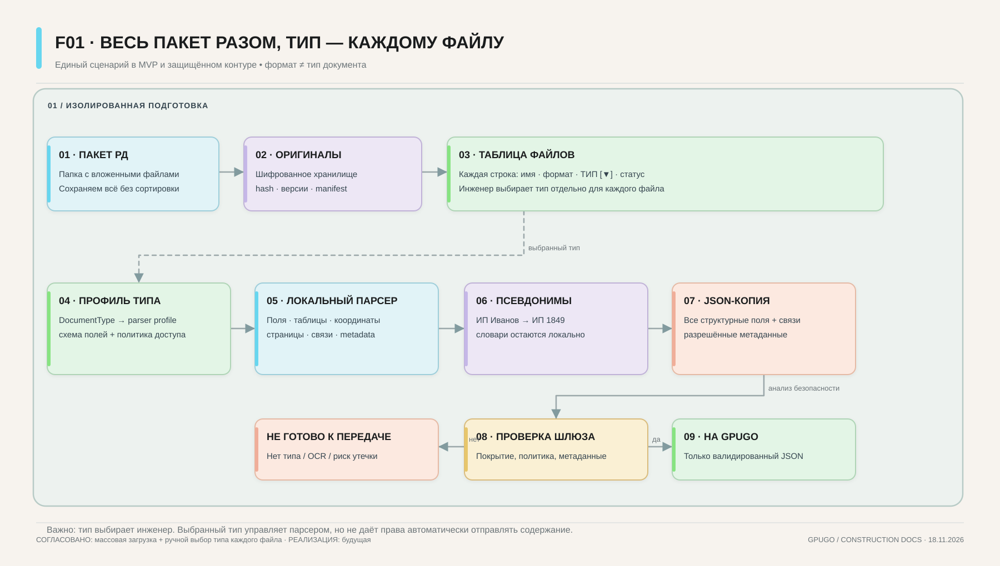
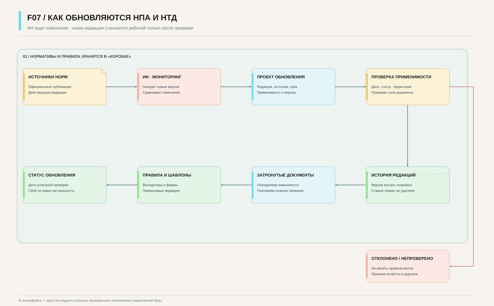

# Construction Docs · GPUGO

**Исполнительная документация — от хаотичной папки с РД до проверяемого комплекта актов, реестров и приложений.**

Windows-приложение с изолированной «коробкой» данных, нормативной базой, формами документов и AI-анализом на GPUGO через контролируемый шлюз.

**Состояние проекта: архитектура согласована · Windows PoC в разработке · production не готов.**  
Обновление архитектуры: **19 ноября 2026**. [История изменений и ревью — PR #1](https://github.com/jetsedpack/construction-docs-saas/pull/1).

---

## Браузерное демо

Откройте [demo/index.html](demo/index.html), нажмите **Download raw file** и запустите скачанный файл в браузере. [Инструкция по работе с демо](demo/README.md).

## 01 / Архитектура за одну минуту


**В центре — постоянная «коробка».** В ней заранее существуют нормативы НПА/НТД, формы, шаблоны и таблицы исполнительной документации. Туда же сначала попадают исходные файлы с чувствительными сведениями. ИИ не получает прямой доступ к исходникам или локальному словарю реквизитов.

За пределы Windows-контура отправляется только **разрешённая структурная копия**: поля, связи, расположение элементов и проверенные метаданные. GPUGO анализирует данные, обнаруживает противоречия и составляет обезличенную структуру результата по правилам «коробки». Локальный шлюз проверяет ответ, адресно возвращает настоящие реквизиты, а Windows-приложение выпускает документы по шаблонам. **Инженер ПТО проверяет и утверждает финальный комплект.**

[**Четыре схемы в одном визуальном атласе**](diagrams/atlas/README.md) · [**Редактируемый draw.io, 4 листа**](diagrams/atlas/architecture.drawio) · [**14 согласованных продуктовых решений**](docs/decisions/2026-11-18-product-contract.md)

## 02 / Четыре ключевых процесса

| F01 · Весь пакет одним действием | F04–F06 · ИИ и выпуск документов |
| :--- | :--- |
| [](diagrams/atlas/f01-intake.svg) | [](diagrams/atlas/f04-f06-roundtrip.svg) |
| Инженер выбирает **тип каждого файла** из справочника. Парсинг и обезличивание происходят локально. | ИИ составляет обезличенный результат. Шлюз проверяет его и **локально подставляет реальные реквизиты**. |

[](diagrams/atlas/f07-norms.svg)

**F07 / Нормативная актуализация.** НПА и НТД находятся внутри «коробки»; ИИ следит за источниками, а система проверяет применимость новых редакций и показывает дату последнего **успешного подтверждённого обновления**. Старые редакции не исчезают.

Все визуальные материалы имеют **редактируемую draw.io-версию** и **готовые SVG-превью**. Схемы переложены 19 ноября: ортогональные стрелки, свободные маршруты, проверка пересечений и переполнения подписей. [Исходник атласа](diagrams/atlas/source.json) · [Проверка геометрии](scripts/check_architecture.py).

---

## 03 / Что реально работает, а что ещё проектируется

| Функция | Статус |
| :--- | :--- |
| Windows-приложение на PySide6 | **PoC**: интерфейс, просмотр находок и история действий |
| Загрузка папки целиком и отдельный выбор типа каждого файла | **Первая реализация PoC**: `batch.py`, каталог из 24 типов, выбор через `QComboBox` |
| Защищённое хранение оригиналов | **PoC**: DPAPI + Fernet, зашифрованные записи и файловые blobs |
| Локальное чтение PDF / DOCX / XLSX / CSV | **PoC**: ограниченные парсеры, без полноценного OCR и DWG |
| Локальная проверка реестров и граф связей | **Частично реализовано**, не охватывает все виды исполнительной документации |
| Клиентский шлюз и серверный GPUGO Edge | **PoC**: сейчас передаются только категории замечаний и числа, не полноценный технический контекст |
| Структурное обезличивание, словарь псевдонимов, содержательный AI-анализ РД | **Специфицировано, не реализовано в полном виде** |
| Генерация комплекта ИД, адресная подстановка реквизитов, DOCX/XLSX/PDF renderer | **Специфицировано, не реализовано** |
| Автоматическое обновление НПА/НТД и нормоконтроль по редакциям | **Специфицировано, не реализовано** |
| Развёртывание модели на 4× RTX PRO 6000D, подписанный инсталлятор, enterprise security | **Не подтверждено реальными испытаниями и выпуском** |

Важное разграничение: **«разработана схема» ≠ «функция уже работает»**. Наличие зашифрованного хранилища и псевдонимов само по себе не доказывает безопасность произвольного пакета строительной документации. Для реальных закрытых файлов нужны модель угроз, проверки утечек и разрешённый режим обработки.

[Точное покрытие функциональных блоков кодом](docs/functional/02-code-coverage.md) · [Технический план вертикального среза](docs/implementation/11-vertical-slice-plan.md).

## 04 / Инженерные материалы

| Артефакт | Зачем открывать |
| :--- | :--- |
| [A0 · Постоянная «коробка»](docs/functional/00-A0-protected-box.md) | Границы доверия, постоянные подсистемы, диалог ПТО, нормативы |
| [F01 · Импорт и обезличивание](docs/functional/03-F01-ingestion-mvp-secure.md) | Пофайловая классификация, MVP и защищённый контур |
| [Контракт F01 → GPUGO → F06](docs/functional/04-structured-roundtrip-contract.md) | Структурная копия, безопасные метаданные, обратная подстановка |
| [JSON Schema запроса](docs/contracts/structured-packet.schema.json) / [ответа ИИ](docs/contracts/prepared-document.schema.json) | Проверяемые форматы обмена, пока **draft** |
| [Каталог типов документов](docs/contracts/document-types.draft.json) | Основа выпадающего списка в F01 |
| [Функциональная спецификация](docs/functional/01-functional-specification.md) | Последовательности F01–F07 и исключения |
| [Дорожная карта реализации](docs/implementation/11-vertical-slice-plan.md) | Модули, зависимости, тесты, критерии готовности |
| [Архитектура безопасности](docs/implementation/04-security.md) / [SECURITY](SECURITY.md) | Текущие и целевые ограничения данных |

Проектный кейс ЧГЭС используется для определения требований. **Реальные документы, реквизиты заказчика, секреты и архивы конфигураций в GitHub не публикуются**; примеры в репозитории синтетические.

## 05 / Запуск текущего Windows PoC

Требуются **Windows 11 x64, Python 3.12 и Git**. Это запуск текущего прототипа, а не установка полноценного SaaS.

```powershell
git clone https://github.com/jetsedpack/construction-docs-saas.git
cd construction-docs-saas
py -3.12 -m venv .venv
.\.venv\Scripts\Activate.ps1
python -m pip install -e ".[desktop,server,dev]"
python -m construction_docs.desktop
```

Локальные проверки:

```powershell
python -m pytest -q
python scripts/check_architecture.py
```

[GitHub Actions](.github/workflows/ci.yml) проверяет тесты Python на Windows/Linux, импорт GUI-модуля на Windows и согласованность архитектурных диаграмм/контрактов. [Последний подтверждённый успешный запуск на момент слияния](https://github.com/jetsedpack/construction-docs-saas/actions/runs/44353780486). Он не заменяет полноценного UI, security и GPU benchmark.

---

**Проектная дисциплина:** исходники неизменяемы, каждый результат связан с источником и редакцией, неподтверждённые сведения не выдаются за факты, ИИ не подписывает акты и не принимает работы за инженера.
