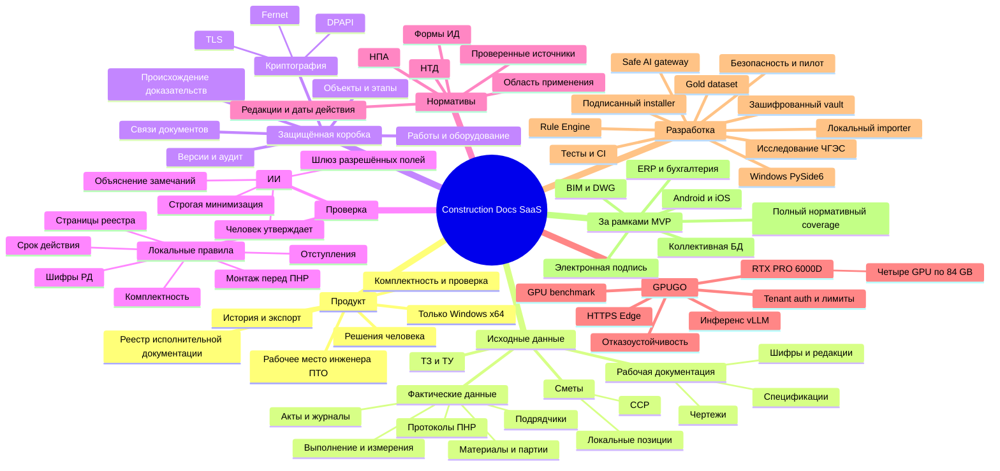
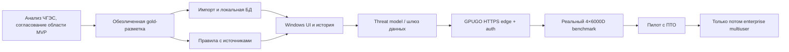

# Карта продукта и его реализации — Windows + GPUGO

Ниже **mind map**, а после — зависимости этапов. Это **проект разработки**, не нормативный справочник и не состояние уже работающего SaaS.

## Критический путь и зависимости

