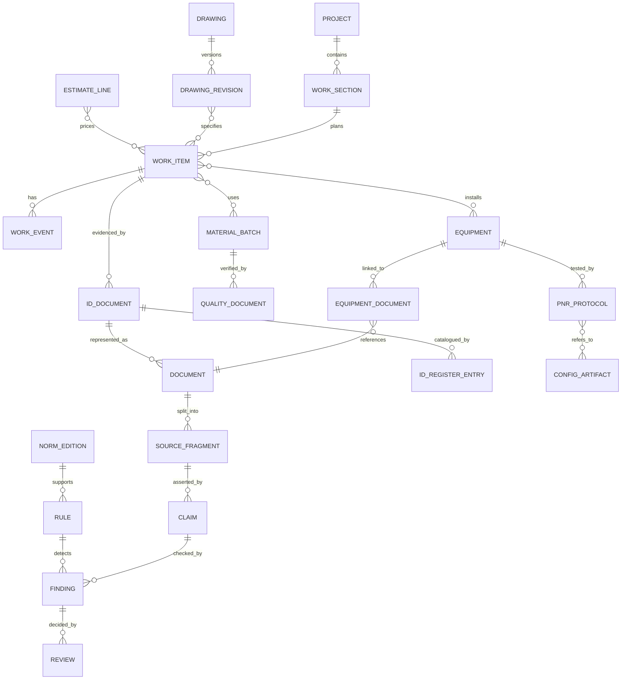
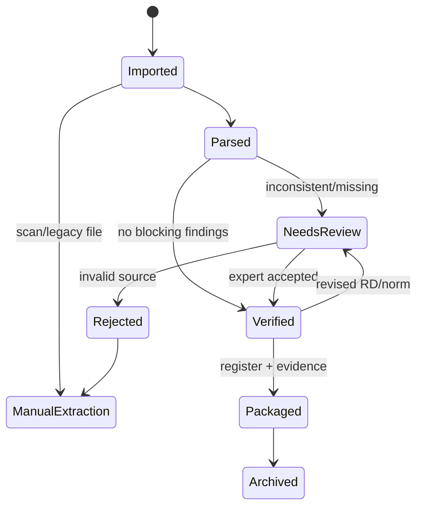

# Предметная ER-модель: объекты, акты, ПНР, доказательства

## Статусы объекта учёта

**Примечание:** статус `Verified` подтверждает только пройденную процедуру проверки внутри продукта. Юридическая подпись и приёмка выполненных работ — отдельные действия уполномоченных лиц.
