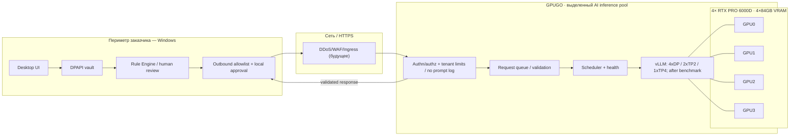
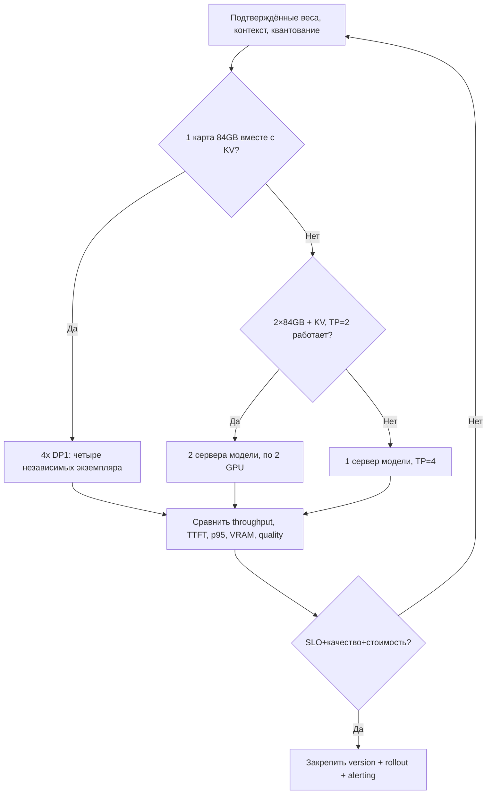

# Развёртывание и расклад GPU

## Четыре варианта планирования

Ограничения: не поднимать порт vLLM в публичную сеть, не хранить запросы и клиентские документы на inference-ноде, проверять лицензии и устройство PCIe. В публичный GPT API нельзя передавать оригинальные документы. Точные числа TPS не заявлены до тестов.
