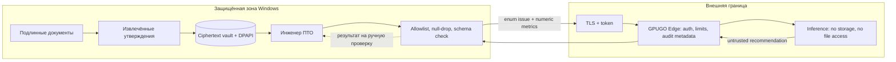

# Data safety, доверие и угрозы

**Threats**: prompt injection, metadata leakage, re-identification, insecure model logging, compromised Windows profile, outdated norm edition, malicious malformed ZIP/DOCX, tool-output spoofing, model hallucinations, unauthorized registry writes. Сведения по каждому риску — [security](../docs/implementation/04-security.md).
