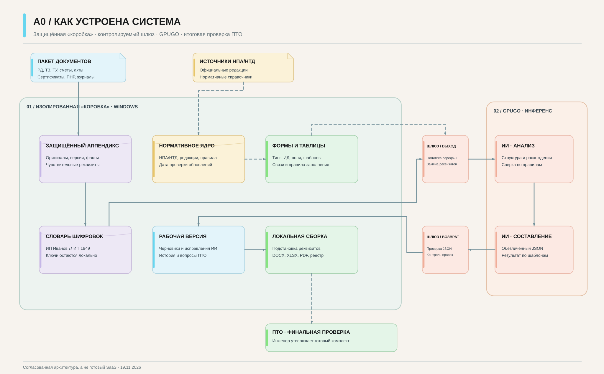
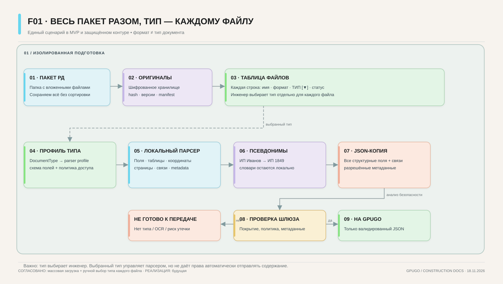
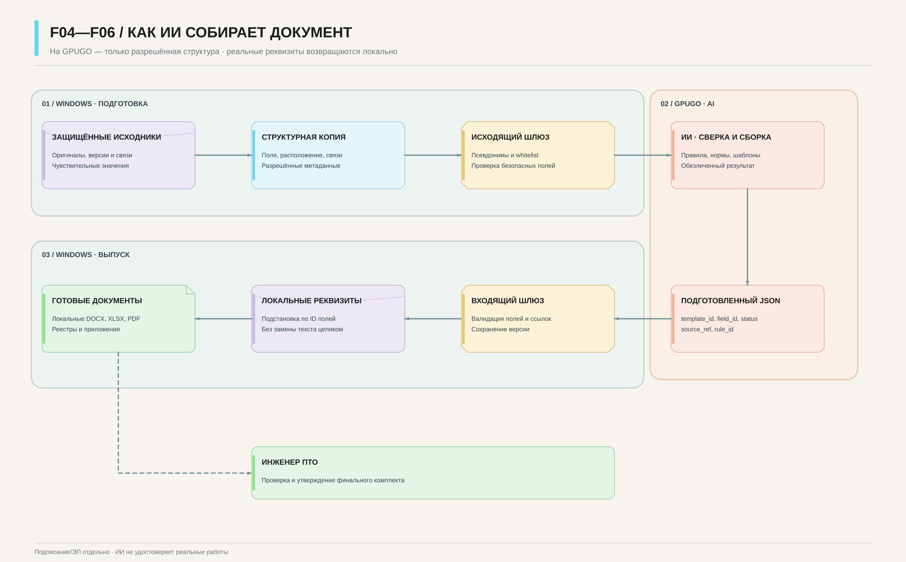
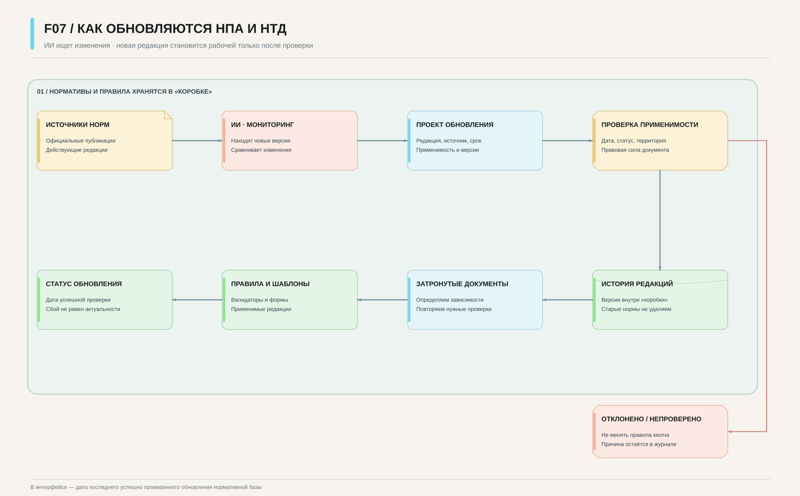

# GPUGO Construction Docs · Architecture Atlas

**Единая визуальная витрина согласованных решений от 18 ноября 2026; полностью переложена 19 ноября после ревью коллизий.** Схемы собраны в одинаковой палитре, привязаны к продуктовым решениям и доступны как SVG-превью и как редактируемый многостраничный draw.io.

**[Открыть draw.io — 4 страницы](architecture.drawio)**. Все стрелки ортогональные, маршруты разведены по пустым коридорам, подписи не пересекают связи. Редактируемый draw.io и четыре SVG-экспорта описывают одну версию схем. Проверка геометрии и текстовых переполнений подключена к CI через `scripts/check_architecture.py`.

## A0 · Изолированная «коробка»

Исходники сначала попадают в закрытый аппендикс; отдельно живут НПА/НТД, шаблоны, таблицы и словарь псевдонимов. Шлюз — единственная граница с GPUGO. ПТО утверждает выходной комплект.

## F01 · Массовая загрузка

Инженер загружает всё одним пакетом, затем выбирает **тип для каждого файла**. Парсер, метаданные и псевдонимы готовят структурную копию; неопределённые по безопасности данные не передаются.

## F04–F06 · Сквозной круг

ИИ возвращает обезличенный структурированный результат по правилам коробки. Внутри Windows шлюз проверяет его, подставляет реальные реквизиты и renderer формирует итоговые формы.

## F07 · Нормативная актуализация

ИИ отслеживает источники, новая редакция проверяется и сохраняется с историей. Дата успешного подтверждённого обновления показывается в интерфейсе.

---

**Оговорки:** все схемы описывают целевую архитектуру; полноценный F01, F06 и F07 ещё не написаны в коде. Старые рисунки в `diagrams/01`–`11` — история исследования, в которой могут встречаться прежние пересечения. **Для показа и дальнейшего редактирования используйте этот атлас.** Схемы не показывают реальные документы ЧГЭС.

[Решения дня](../../docs/decisions/2026-11-18-product-contract.md) · [Точный план работы](../../docs/implementation/11-vertical-slice-plan.md) · [Матрица статусов кода](../../docs/functional/02-code-coverage.md)
