# Концепция системы: исполнительная документация как связанные данные

Статус: **проектная гипотеза**, по пояснениям владельца идеи от 18.11.2026. Это концепция данных и процессов, а не окончательный перечень нормативов, технический стек или юридическое заключение.

## Основная мысль

Сервис не просто генерирует формы: он ведёт защищённую систему взаимосвязанных записей об объекте, этапах, работах, сметах, фактическом исполнении, материалах, исполнителях и документах. ИИ выявляет пропуски/несоответствия и предлагает исправления. ПТО проверяет и утверждает.

**Редактируемая визуальная схема:** [Открыть файл .drawio](../diagrams/01-construction-data-flow.drawio) в diagrams.net.

## Упрощённая карта потоков

```mermaid
flowchart TB
    I["Исходные ТЗ, ТУ, РД, ССР, спецификации и фактические данные"] --> G["Шлюз приёма и защиты данных"]
    G --> |"минимизированный контекст"| A["ИИ: сопоставление, ошибки, предложения"]
    N["НПА / НТД: официальные источники и проверенные редакции"] --> V["Контроль актуальности и применимости"]
    V --> BOX
    A --> |"предложения, ссылки на основания"| VAL["Проверка формата, связей и правил"]
    VAL --> |"допустимые изменения"| BOX[("Защищённая коробка: связанные сущности, ИД, нормы, версии")]
    BOX -. "разрешённый контекст через шлюз" .-> G
    BOX --> PTO["ПТО: верификация и утверждение"]
    PTO --> BOX
    BOX --> O["Реестры, акты, исполнительные схемы, журналы, комплекты, архив"]
```

## Что является «коробкой»

Это логическая граница доверия, внутри которой находятся:

1. **Проектные и организационные сущности:** объекты, этапы, виды работ, подрядчики, договоры, закупки, материалы и документы.
2. **Нормативно-справочный слой:** применимые НПА, НТД, редакции, даты действия, правила проверки, формы и шаблоны.
3. **Исполнительная документация:** реестры, акты, схемы, журналы, результаты испытаний, документы контроля, связи с выполненными работами.
4. **Управление качеством данных:** происхождение каждого утверждения, ревизии, статусы, история проверки и действий ПТО.
5. **Доверенные персональные/коммерческие реквизиты:** хранятся с разграничением доступа в защищённом периметре.

«Коробка» — не только БД в узком смысле. На концептуальном уровне это защищённый **контур хранения, правил и контроля изменений**. Реализация может включать несколько специализированных хранилищ; физическая архитектура пока не утверждена.

## Различаем три типа сведений

| Тип | Пример | Можно ли считать подтверждённым? |
| --- | --- | --- |
| Исходное утверждение | В РД указано изделие/размер/марка | Пока только содержание источника; проверить актуальность версии |
| Факт исполнения | Выполненная работа подтверждена актом и результатом контроля | После установленных процедур проверки |
| Предложение ИИ | «Марка материала в сертификате не совпадает со спецификацией» | Нет, это замечание к проверке |

Ни одна генерация ИИ не должна сама по себе означать, что работа фактически выполнена, испытание проведено или должностное лицо подписало документ.

## Состав ИД и связь с соседними контурами

По приказу Минстроя № 344/пр в состав ИД включаются типы актов, исполнительные схемы, результаты испытаний, документы входного контроля и журналы работ. Перечень конкретного объекта утверждается согласно установленному порядку. Закупки, бухгалтерские документы, договоры, сметы и подрядчики — **связанный контекст**, а не автоматически элементы ИД.

ССР по приказу № 421/пр описывает сметную стоимость и структуру затрат; его данные полезны для сопоставлений, но не подменяют подтверждение фактического исполнения.

## Сквозной пример (условный)

1. Из рабочей документации извлечено требование к материалу.
2. Из спецификации и документа входного контроля извлечены реквизиты фактически применённого материала.
3. Система сопоставляет обозначения, единицы измерения, версии РД и требования применимого стандарта.
4. ИИ обнаруживает несовпадение, показывает обе цитаты/страницы и предлагает варианты устранения.
5. ПТО выясняет, ошибка ли это распознавания, документа, материала или согласованное изменение проекта.
6. Проверенное решение меняет статус связанной записи и отражается в реестре и комплекте ИД.

## Пока не решено

- Правила первой загрузки коммерческих и персональных данных в изолированный контур: по описанию внешними входами коробки являются ответы ИИ и обновления нормативов, однако первоначальные доверенные реквизиты всё равно требуется где-то зарегистрировать.
- Какие документы и отрасли входят в первый пилот.
- Кто подтверждает изменение РД и факт выполнения работ.
- Где физически работает модель и какие сведения разрешено ей предоставлять.
- Доступность и лицензии для системных обновлений нормативной базы.

Источники и ограничения: [регуляторные ориентиры](regulatory-sources.md), [границы безопасности](security-boundaries.md), [модель данных](data-model.md).
