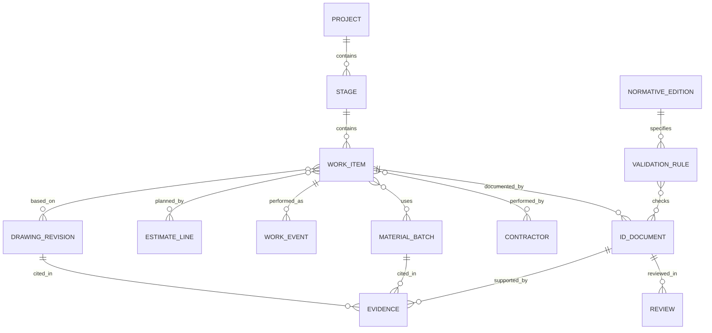

# Табличная модель «коробки» — первый черновик

Это **логическая** схема данных. Названия таблиц, состав полей и связи будут уточняться по реальным образцам из стройки. Данные не ограничиваются пятью колонками, нарисованными на исходном эскизе.

## Основные группы записей

| Группа | Возможные сущности | Для чего |
| --- | --- | --- |
| Объект | project, stage, location, work_package | Структура стройки и этапов |
| Проектирование | drawing, drawing_revision, specification_item, technical_condition | Что предусмотрено проектом и какой редакцией |
| Сметы | estimate, estimate_line, work_quantity_plan | Плановые объёмы и затраты; ССР — агрегирующий документ |
| Производство | work_item, work_event, actual_quantity, inspection | Что реально произошло, когда и на каком основании |
| Участники | organization, contractor, person, role, authority | Кто выполняет, проверяет и утверждает |
| Материалы и поставки | material, batch, delivery, certificate, incoming_control | Прослеживаемость материалов и документов качества |
| Договоры и экономика | contract, subcontract, procurement, payment_reference | Сопутствующие данные, не подменяющие ИД |
| Исполнительная документация | id_register_entry, id_document, act, drawing_asbuilt, log_entry | Представление и комплектность ИД |
| Нормативы | normative_document, edition, effective_period, rule, template | Применимые требования и проверяемые формы |
| Надёжность данных | evidence, source_span, conflict, review, approval, audit_event | Основания утверждений, замечания, история |

## Концептуальные связи

## Обязательные атрибуты прослеживаемости

Для каждого значимого утверждения желательно хранить:
- идентификатор объекта, работы и исходного документа;
- редакцию, дату, страницу/фрагмент источника;
- тип: исходное утверждение, установленный факт, предположение, замечание ИИ;
- статус проверки человеком;
- применимое нормативное основание с редакцией и датой действия;
- автора или источник изменения, время и историю версий.

**Нельзя** смешивать `planned_quantity` из сметы, `reported_quantity` из записи исполнителя и `verified_actual_quantity` после подтверждения. Аналогично, `AI_suggestion` не равна `approved_change`.

## Реестр ИД (пользовательское представление)

| Раздел | Документ / запись | Работа | Ответственный | Нормативное / проектное основание | Статус |
| --- | --- | --- | --- | --- | --- |
| Акты | Акт освидетельствования скрытых работ | Ссылка на вид/объём работ | Подрядчик / проверяющий | РД, применимая форма, подтверждающие документы | Черновик / на проверке / утверждён |
| Схемы | Исполнительная схема | Конструкция/сеть и местоположение | Исполнитель | Рабочие чертежи, результаты измерений | В работе / проверено |
| Журналы | Запись общего/специального журнала | Работы и даты | Уполномоченное лицо | Фактические записи и правила ведения | Создано / подтверждено |
| Качество | Документ контроля материала | Партия материала / работа | Поставщик / служба контроля | Сертификат, паспорт, протокол | Ожидает / принято |

Список и поля — демонстрационные. Их необходимо сверить с утверждённым перечнем ИД конкретного объекта и реальными таблицами заказчика.
