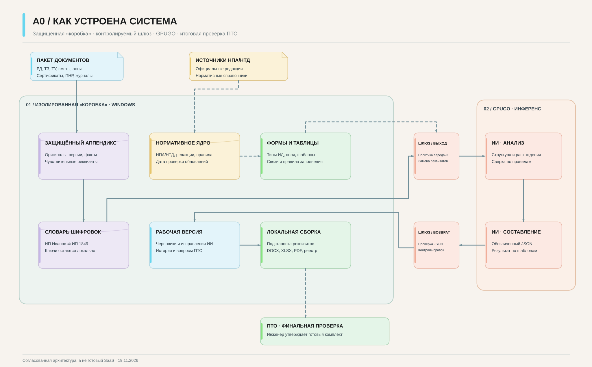

# Product contract / 18 ноября 2026

> Сводка **согласованных сегодня требований** к Construction Docs SaaS для GPUGO. Это проектное решение, не отчёт о готовой реализации. Первоисточник дальнейших спецификаций; для настоящих документов нужен отдельный security review.

## Согласовано

| ID | Решение | Важное следствие |
| --- | --- | --- |
| ADR-01 | Основной клиент — **Windows**. Мобильное и планшетное приложение в MVP не нужны. | UI и локальное хранилище живут на Windows; GPUGO предоставляет inference. |
| ADR-02 | «Коробка» **существует до импорта**: нормативы НПА/НТД, правила ведения ИД, шаблоны, формы, типы и табличная структура. | ИИ не создаёт коробку, а работает по её правилам. |
| ADR-03 | Исходные документы **сразу помещаются в закрытый аппендикс коробки**. | Нельзя слать оригинальные PDF, РД, имена и реквизиты напрямую в GPUGO. |
| ADR-04 | Инженер бросает **весь пакет файлов одновременно**, но **выпадающим списком указывает тип каждого файла отдельно**. | Нужны batch importer + per-file classification table + профили обработки по типу. |
| ADR-05 | Тип документа задаёт сценарий парсинга/обезличивания, но **сам по себе не разрешает передачу**. | Отдельная policy-проверка исходящего контекста по содержимому и задаче. |
| ADR-06 | Через шлюз направляется **структурная копия**, а не собранный заново PDF/DOCX/XLSX. | Сохраняем полный состав полей, связи, порядок, адреса фрагментов и безопасные метаданные; запрещённые значения заменяются placeholders/alias. |
| ADR-07 | Закрытый словарь соответствий остаётся локально: `ИП Иванов ⇄ ИП 1849`. | Сквозные псевдонимы между файлами; обратная подстановка только внутри коробки. |
| ADR-08 | GPUGO AI должен анализировать документацию, находить расхождения, применять правила/формы и формировать **обезличенный структурированный выход**. | Нужны содержательные контракты запросов и результатов, а не только код замечания. |
| ADR-09 | AI-вывод проходит обратную проверку шлюза, сохраняется как **промежуточная версия** коробки. | Никаких правок оригиналов, история и rollback обязательны. |
| ADR-10 | Шлюз **адресно вносит реальные реквизиты после возвращения AI**, а локальный renderer выпускает итоговый DOCX/XLSX/PDF и реестр. | AI не формирует финальный открытый файл с чувствительными данными на GPUGO. |
| ADR-11 | Инженер ПТО задаёт вопросы о промежуточном состоянии через шлюз естественным языком. **Утверждает только финальный пакет**. | Не требуется ручное согласование каждого AI-шага; утверждение готовой ИД — отдельный UX-этап. |
| ADR-12 | Внутри коробки живут НПА/НТД и их редакции. ИИ отслеживает источники, подготавливает обновление; при запуске показываем **дату последнего успешного подтверждённого обновления**. | Immutable editions, проверка правового статуса/дат/области применения, правила и история; не путать проверку с попыткой обновления. |
| ADR-13 | Цель — полный охват и минимизация ошибок сверки и составления. | Реестр `imported / classified / parsed / sanitized / analyzed / verified / blocked`; автоматические детерминированные сверки и запрет молчаливых пропусков. **Гарантии нулевой ошибки LLM нет.** |
| ADR-14 | Два уровня поставки: **ограниченный MVP** и **усиленный защищённый контур**, общий сценарий интерфейса. | Разные контроли OCR, изображений, hidden metadata, containment, re-identification и эксплуатационной безопасности. |

## Основной поток

`Пакет файлов → закрытый аппендикс → тип для каждого файла → локальный парсер → структурная копия (поля + связи + позиции + разрешённые метаданные) → псевдонимы → шлюз → GPUGO AI + правила коробки → обезличенный результат → шлюз/валидация → промежуточная версия → локальная подстановка реквизитов → рендер по формам → итоговый пакет → финальная проверка ПТО.`

Дополнительно: `источники НПА/НТД → AI updater → проверяемая новая редакция в коробке → затронутые правила/проекты → контроль актуальности + дата`.

## Строго различать

**Цель продукта** — полноценная анализирующая и составляющая ИД система; **текущий код** — узкий учебный PoC, который импортирует отдельные файлы, проверяет часть Excel-реестров и отправляет на GPUGO только категорию замечания с числами. Он не умеет передавать безопасную содержательную копию и не реализует согласованный F01/F06.

**Структурная полнота** ≠ публикация всех реальных значений. Все поля регистрируются, но запрещённые значения могут быть заменены типизированными placeholders или заблокированы для передачи. Безопасность нельзя гарантировать одними regexp или заменой ФИО.

**«Сформировать документ»** ≠ «подписать документ» и ≠ «удостоверить факт выполнения». Источник факта должен оставаться проверяемым.

## Что ещё требует обсуждения

| Вопрос | Почему важен |
| --- | --- |
| F02: первичность проектных / фактических / договорных сведений при конфликте | Нельзя автоматически выбрать «истину» из двух разных по происхождению источников. |
| Каталог DocumentType и его полнота | «Все виды нужных документов» требует доменной матрицы по дисциплине и этапу работ. |
| Где технически проходит граница безопасной метаинформации | Инженерные характеристики и сочетания полей тоже могут идентифицировать объект. |
| Политика ошибок OCR/неизвестных слоёв | Для непрозрачного файла необходимо честное `blocked / needs_attention`. |
| Источники НТД, лицензии, обязательность редакций | Не всякое опубликованное изменение автоматически применимо к проекту. |
| Как устроены версии согласованных форм/шаблонов заказчика | Выходные требования могут отличаться по проекту. |
| Какая модель/TP/DP на четырёх RTX PRO 6000D и реальные SLO | Нельзя выбрать аппаратную конфигурацию без benchmark. |

## Навигация по демонстрационным артефактам

[Редактируемый draw.io (4 страницы)](../../diagrams/atlas/architecture.drawio) · [F01 спецификация](../functional/03-F01-ingestion-mvp-secure.md) · [F01↔F06 контракт](../functional/04-structured-roundtrip-contract.md) · [План работ](../implementation/11-vertical-slice-plan.md).
