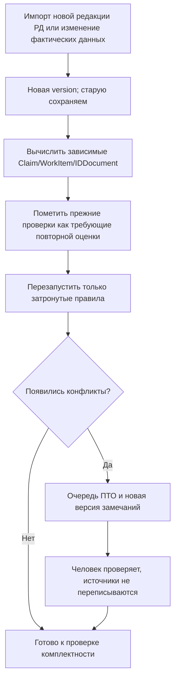

# Функциональная декомпозиция: контракты и алгоритмы

Каждому номеру соответствует страница [в draw.io](../../diagrams/09-functional-architecture.drawio). Технические детали компонентов и риски — в [implementation](../implementation/01-architecture.md).

## F00 — контекст проекта и доверия (сквозная функция)

**Триггер:** сотрудник создаёт/открывает объект и выбирает раздел работ.

**Вход:** объект, этап, участок, дисциплина (например, электромонтаж или ПНР), договорной контекст, каталог исходных файлов, роли и режим доступа.

**Действия:**
1. Установить контекст проекта и нормативную дату/тип работ — без них нельзя понять, какие документы обязательны.
2. Разделить права: инженер ПТО/проверяющий/утверждающий/администратор (production). В локальном PoC один Windows-пользователь, нет командного RBAC.
3. Создать устойчивые project_id и идентификаторы документов. Каждой версии исходника присвоить hash.
4. Зафиксировать разрешение или запрет внешней AI-обработки для проекта; по умолчанию запрещено.
5. Обеспечить шифрование и историю операций. Никакое содержание не должно отправляться наружу автоматически.

**Выход:** ProjectContext, защищённая зона документов, разрешения, журнал. **Статус:** частично (локальная Windows-коробка без полноценной структуры проектов и ролей).

---

## F01 — массовая загрузка с отдельным выбором типа каждого файла

**Согласовано:** инженер загружает **всю папку/пакет одновременно**, а затем **для каждого файла отдельно выбирает его предметный тип** из раскрывающегося справочника «коробки». Это не выбор одного общего типа на пакет и не автоматическая классификация вместо инженера.

**Тип документа** (например, спецификация, рабочий чертёж, акт, реестр, журнал, протокол) определяет профиль разбора и обезличивания. **Формат файла** (PDF, XLSX, DOCX) определяется отдельно; нельзя смешивать расширение с предметным типом.

**Алгоритм:**
1. Массово импортировать дерево файлов в закрытый аппендикс коробки. До внешнего AI сохранить неизменяемые оригиналы с hash и локальным manifest.
2. В единой таблице показать **каждый** файл и раскрывающийся список типов. Пока тип не выбран, файл остаётся `needs_classification` и не попадает на GPUGO.
3. Применить по выбранному типу `ParserProfile → ExtractionSchema → SensitiveFieldPolicy → OutputSchema`, всё внутри Windows-контура.
4. Локально разобрать документы, выделить фрагменты с координатами/ссылками на исходный файл, страницы, листы, ячейки. Неизвестные форматы и сканы без извлечённого текста явно отметить как неподготовленные.
5. Создать локальный защищённый словарь чувствительных реквизитов (например, `ИП Иванов ⇄ ИП 1849`), заменять их согласованно между файлами, не выпускать словарь за контур.
6. **Собрать не исходный обезличенный файл, а структурированное представление для ИИ:** все извлечённые поля, адреса/геометрия, связи и допустимые метаданные; чувствительные значения — только placeholders/псевдонимы, исходные метаданные отдельно фильтруются.
7. Шлюз независимо проверяет допустимость каждого поля для конкретной задачи AI. Утверждённый пакет и правила/шаблоны коробки идут на GPUGO; ИИ возвращает **обезличенную структуру подготовленного документа**. Ответ валидируется, записывается в промежуточную версию «коробки», а чувствительные данные затем подставляются локально при выпуске.
8. По каждой позиции отдельно ведётся статус `imported → classified → parsed → anonymized → gateway_approved → analyzed`; ошибки и неполнота остаются видны.

**Два профиля реализации:** MVP — ограниченные форматы и виды документации, локальный whitelist/pseudonymization, fail-closed; усиленный контур — безопасность изображений, скрытых данных, метаданных, косвенной идентификации, sandbox парсеров и аудит. Ручной выбор типа **не заменяет** автоматическую проверку безопасности.

**Выход:** оригиналы в защищённом хранилище, табличная классификация, реестр обработанных/заблокированных файлов, обезличенный структурный AI-пакет для разрешённых фрагментов.

**Текущий PoC:** поддерживает импорт **одного** файла и базовые парсеры, но не имеет массовой классификации, профилей по предметному типу, alias-словаря и безопасной сборки технического контекста. [Отдельная подробная спецификация и схема](03-F01-ingestion-mvp-secure.md).

---

## F02 — нормализация и сборка связанных строительных данных

**Триггер:** получены фрагменты F01 или изменена версия первичного документа.

**Вход:** SourceFragment, данные реестра ИД, проектные позиции, сметные позиции, оборудование, материалы, этапы работ и результаты проверки.

**Алгоритм:**
1. По типу источника выбираем шаблон извлечения: реестр ИД, РД/спецификация, АОСР, журнал, сертификат, протокол ПНР. Если шаблон неизвестен — ручная разметка.
2. Порождаем **отдельные утверждения** (Claim): `субъект`, `поле`, `значение`, `тип происхождения`, `ссылка на источник`, `статус доверия`, `версия`.
3. Нормализуем даты, единицы, обозначения, номера документов, редакции РД. Не приводить разные марки к одной «похожей» без подтверждения.
4. Дедуплицируем **файлы по hash**, а логические документы — по подтверждённым реквизитам и версиям; одинаковые названия не достаточны.
5. Предлагаем связь с `Object/Section/WorkItem/Equipment/MaterialBatch/IDDocument/PNRProtocol` по устойчивым идентификаторам, реквизитам и контексту.
6. Для неоднозначных связей — очередь сопоставления ПТО. **Не сливать** два шкафа с похожим наименованием в одно оборудование.
7. Записываем граф и ссылки в коробку, сохраняя оригинальные утверждения и историю изменения редакций.

**Выход:** канонические сущности, candidate links/approved links, provenance graph, неподтверждённые конфликты.

**Пример из класса данных ЧГЭС:** один шкаф имеет паспорт, акт передачи в ПНР, протокол испытаний, конфигурацию; они привязаны к одному `Equipment` только после проверки тождества, а не по похожему имени.

**В PoC:** реализованы графовые примитивы + шифрованное сохранение; извлечение полноценных Claim и автоматическое entity resolution не реализованы.

---

## F03 — контроль комплектности и противоречий

**Триггер:** импортировано/изменено исходное утверждение, ручная команда «Проверить», обновлена нормативная редакция.

**Вход:** утверждения F02, версия РД, документы контроля и исполнения, условия проекта, нормативные правила F07.

**Алгоритм:**
1. Определить проверяемый объект, вид работ, период и **применимые редакции** НПА/НТД и утверждённые проектные требования.
2. Выполнить локальные детерминированные правила, не заменяя ими экспертное суждение.
3. На уровне реестра проверить диапазоны страниц, число листов, пересечение диапазонов, наличие служебных ссылок/статусов.
4. На уровне проект↔факт проверить объёмы и обозначения: например, проектная длина кабеля vs зафиксированная фактическая, наличие оснований для отклонения, соответствие спецификации документу качества.
5. Проверить связность комплекта: АОСР ↔ выполненная работа ↔ исполнительная схема ↔ акт контроля ↔ журнал; смонтированное оборудование ↔ акт передачи в ПНР ↔ протокол.
6. Для правила создать `Finding{category, severity, source_evidence, observed, expected, rule_revision, suggested_action, status}`.
7. Разделить ошибки **данных**, **неполноту документов**, **несогласованную версию**, **сомнительные утверждения**. Не писать «незаконно», если нет достаточного правового основания.
8. Если источник неоднозначен — пометка «требуется человек», а не автоматическая правка.

**Выход:** воспроизводимый список замечаний со ссылками на источники/нормы, отметка о неприменённых правилах.

**В PoC:** только пункты 3 (четыре проверки Excel-реестров); нормо- и междокументные проверки пока спроектированы, не реализованы.

---

## F04 — безопасная AI-подсказка на GPUGO

**Триггер:** после F03 ПТО отдельно нажал «Запросить AI» и подтвердил точный состав outbound.

**Вход:** замечания F03 и ограниченная политика проекта. **Не вход:** оригинальные PDF, РД, параметры РЗА, конфигурационные архивы, полные реестры, ФИО, номера договоров.

**Алгоритм — текущий PoC:**
1. Клиентский `safe_batch()` пропускает только category, severity и разрешённые целые метрики, даёт индекс внутри запроса. Поле `message`, номера строк и document_id отбрасываются.
2. Показываем пользователю JSON, endpoint и спрашиваем явное разрешение.
3. Отправляем HTTPS запрос на выделенный GPUGO Edge; проверка адреса/пути и отсутствие redirect.
4. Серверный Edge **повторно валидирует** поля, системную инструкцию и размер, проверяет token. В PoC статический bearer; industrial tenant auth/quota не сделаны.
5. Edge пересылает только безопасный DTO на внутренний vLLM endpoint; worker GPU исполняет модель.
6. Edge разбирает и строго проверяет JSON ответа `recommendations[index, action, rationale]`, затем клиент проверяет ответ повторно.
7. Ответ привязывается к **локальной** находке только по request-local index; в БД не происходит автоматической правки.
8. Timeout/429/502/не-JSON — безопасный отказ, локальная работа продолжается.

**Ограничение:** модель видит лишь абстрактный тип ошибки и числа. Поэтому она может объяснять способ проверки, **но не способна по такому payload сравнить РД и акт**. Для содержательного AI нужны новый whitelist разрешённых структурированных технических полей, политика реидентификации/угроз, разметка, тесты утечек, договорной режим обработки — после отдельного согласования.

**Выход:** недоверенная рекомендация, пригодная только для решения человека. **В PoC:** оба шлюза реализованы как код, но реальный inference на 4×6000D и production hardening ещё не выполнены.

---

## F05 — диалог инженера с промежуточной версией, без обязательной промежуточной приёмки

**Согласовано:** инженер ПТО вправе задавать любые предметные вопросы по промежуточной версии естественным языком. Но **не утверждает каждый шаг ИИ**; его обязательная проверка и утверждение относятся к **финальному комплекту F06**.

**Вход:** вопрос инженера и текущее состояние промежуточной версии в коробке (Claim, ссылки на РД, правила, замечания, неразобранные участки).

**Цикл:**
1. ПТО задаёт вопрос. Локальный gateway превращает закрытые имена/реквизиты в устойчивые псевдонимы и собирает минимально достаточную структурную копию по запросу.
2. Политика outbound проверяет безопасность текста, метаданных и связей. Неизвестный/опасный контекст не отправляется.
3. GPUGO отвечает с использованием псевдонимов и только доступных источников, может предложить исправления рабочей версии.
4. Внутри коробки ответ валидируется; локально восстанавливаются разрешённые реквизиты для отображения инженеру.
5. Разрешённые изменения попадают только в **версионированную промежуточную модель**; запускаются автоматические проверки полноты/противоречий. Оригиналы остаются нетронутыми.
6. Система может запросить дополнительные данные, но не выдавать неподтверждённое за выполненную работу.

**Выход:** ответы инженеру, обновлённая промежуточная версия, журнал вопросов/исправлений, перечень непроверенного. **Промежуточная подпись ПТО не требуется.** Текущий PoC не поддерживает такой содержательный диалог: `desktop.py` лишь выводит абстрактные рекомендации.

---

## F06 — составление структурированного результата ИИ, локальная подстановка реквизитов и выпуск ИД

**Триггер:** через итерации F02–F05 получена рабочая версия и выполнены проверки; требуется подготовить итоговый комплект.

**Вход:** структурированные обезличенные сведения, связи, расположение, допустимые метаданные, версии шаблонов и нормативных правил «коробки», проверенные исходники из защищённого аппендикса, локальный закрытый alias-словарь.

**Алгоритм (проект):**
1. «Коробка» выбирает применимые правила, утверждённые формы и шаблоны для типа документа и объекта; проверяет дату, редакцию и комплектность.
2. Шлюз направляет на GPUGO **структурированный безопасный контекст**, разрешённые правила и структуру ожидаемого результата (template ID/version и JSON schema).
3. **ИИ составляет обезличенный выход**: разделы, таблицы, значения, связи, метаданные, ссылки на проверенные источники и placeholders чувствительных реквизитов в предусмотренной форме. Не придумывает отсутствующих данных.
4. Шлюз на возвращении проверяет JSON schema, ссылки на исходные поля, допустимость значений, нормативные основания и целостность placeholders; отклоняет неподтверждённые или испорченные поля.
5. Валидируемый результат сохраняется **как промежуточная версия внутри коробки**; оригинальные документы не изменяются.
6. **Локальный gateway / alias resolver** заполняет placeholders реальными данными из защищённого аппендикса и словаря соответствий. Подстановка **адресная, по ID полей**, а не глобальная замена текста.
7. **Локальный renderer** использует формы и шаблоны «коробки», чтобы получить итоговые DOCX/XLSX/PDF, реестр и приложения; не нужно собирать обезличенный исходный PDF.
8. Локальный контроль проверяет охват всех документов, наличие всех обязательных реквизитов, арифметику и связи, правильность псевдонимизации/восстановления, отсутствующие основания. Сбой → новая автоматическая итерация, с явным отчётом об ограничениях.
9. **Только готовый финальный пакет** передаётся инженеру ПТО для проверки и утверждения. При замечаниях — новый цикл, а не перезапись исходного оригинала.
10. После утверждения — отдельный юридический процесс подписи/ЭП, если применимо, и экспорт с manifest, hashes и историей версий.

**Выход:** комплект ИД с настоящими реквизитами, реестр, приложения, отчёт полноты, ссылки на источники. **Не реализовано в PoC.** Схема контракта: [F01 → GPUGO → F06](04-structured-roundtrip-contract.md).

---

## F07 — обновление нормативной базы и применимость редакций

**Триггер:** новая публикация НПА/НТД или ручная регистрация редакции.

**Вход:** проверенный источник публикации, документ и реквизиты, дата вступления в силу, территория, вид объекта/работ, версии, лицензия, эксперт.

**Алгоритм (проект):**
1. Получить документ из разрешённого источника или импорта оператора.
2. Выяснить, новая ли это редакция; зафиксировать хеш и реквизиты.
3. **Не заменять старую версию:** отдельная immutable `NormativeEdition`.
4. Отдельно проверить правовой статус, область применения, исключения, дату действия, регион, отрасль, договорные нормы.
5. Эксперт подтверждает извлечённые правила; сомнительные требования не активируются автоматически.
6. Создать versioned `Rule`; определить затронутые объекты и документы.
7. Перепроверить только те дела, к которым норма применима на нужную дату; предъявить ПТО новые замечания.
8. Учесть лицензии платных систем: наличие доступа в браузере **не равно** праву массово выгрузить контент.

**Выход:** версии норм, версии правил и impact report. **В PoC:** ручная registration/date-applicability в `norms.py`; импорт официальных обновлений, применение к rule engine, экспертные approval ещё не сделаны.

---

## X01 — отказоустойчивость, контроль доступа, аудит

Глобальные меры: локальный доступ Windows, DPAPI key wrapping, Fernet encrypted data, TTL на API token (production), HTTPS, offline-first, отсутствие реальных документов в GPUgo logs, обязательный security review перед настоящими файлами. DPAPI+Fernet **не означает** полную защиту от локального администратора или атакующего под учётной записью пользователя; SQLite-файл не шифруется целиком. Для многопользовательской установки необходим отдельный защищённый сервер заказчика с транзакциями, RBAC, backup/restore, аудитом и политиками данных.

## Что происходит при изменении документа

Это целевое поведение, **пока не реализовано** в коде.
