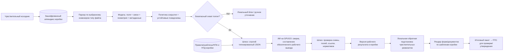

# Контракт F01 → ИИ GPUGO → F06: структурная копия, метаданные и обратная подстановка

**Решение пользователя:** необязательно восстанавливать исходный обезличенный PDF, DOCX или XLSX. Достаточно структурированной копии для модели, сохраняющей **все извлекаемые поля, связи, расположение элементов и метаданные**, при условии, что *чувствительные значения и раскрывающие метаданные* не пересекают шлюз. На выходе **ИИ формирует правильный рабочий документ по формам и правилам «коробки»**; шлюз в изолированном контуре локально подставляет чувствительные значения, формируется готовый документ на проверку ПТО.

## Последовательность данных



## 1. Что передаётся ИИ

**Содержательная структурная копия**, не исходный бинарный файл:
- выбранный человеком **предметный тип каждого файла** (`document_type`) и версия профиля обработки;
- **логические поля**: номер позиции, единица измерения, длина, дата и т.п. — только разрешённые для задачи значения;
- **расположение**: страница, лист, ячейка, блок, таблица, диапазон, относительные координаты, порядок чтения и вложенность; данные расположения тоже проверяются на косвенную идентификацию;
- **связи**: чертёж → позиция → материал → работа → акт → ПНР, только через временные / безопасные идентификаторы;
- **метаданные**: формат, размерные характеристики, номер редакции, дата вида «когда действует», тип источника, уверенность парсера, версия правил, полнота; но не оригинальный путь, ФИО автора, компания, название объекта, GPS, embedded property или другой чувствительный атрибут без отдельного разрешения;
- **псевдонимы** вместо закрытых сущностей: `ИП 1849`, `CONTRACT-204`. Таблица сопоставления остаётся исключительно в коробке;
- **правила и шаблоны коробки** в разрешённом для AI виде — версия формы, обязательные поля, валидаторы, применимые редакции НПА/НТД, ограничения вывода.

Фраза «сохранить все поля» означает сохранить **структуру и полноту учёта**, а не передать наружу все фактические значения. Для запрещённых значений сохраняется типизированный placeholder; в unsafe metadata — такой же режим.

## 2. Пример условного запроса на GPUGO (синтетический)

```json
{
  "schema_version": "draft-0.1",
  "task": "reconcile_and_compose",
  "documents": [{
    "id": "DOC-1",
    "type": "work_documentation",
    "format": "xlsx",
    "processing_profile": "rd_tables_v1",
    "metadata": {
      "revision": "2",
      "pages": null,
      "sheets": 3,
      "source_title": "[REDACTED]"
    },
    "fields": [
      {"id": "F1", "path": "sheet:2/cell:D8", "field": "contractor", "value": "ИП 1849", "kind": "alias"},
      {"id": "F2", "path": "sheet:2/cell:F8", "field": "planned_length_m", "value": 20, "kind": "number"},
      {"id": "F3", "path": "sheet:2/cell:G8", "field": "recorded_length_m", "value": 33, "kind": "number"}
    ],
    "relations": [{"from": "F2", "to": "F3", "kind": "compare_length"}]
  }],
  "template": {"id": "id_register_template", "version": "3", "required_fields": ["contractor", "planned_length_m", "recorded_length_m"]},
  "normative_rules": [{"rule_id": "LOCAL-RULE-1", "edition": "v2", "check": "compare_numbers"}],
  "coverage": {"files_total": 1, "fields_detected": 3, "fields_ready": 3}
}
```

**Этот JSON — концептуальный пример, не действующий API.** Метаданные тоже бывают чувствительными; поле с меткой `REDACTED` может быть локально опущено полностью. Для production нужна схема с явным whitelist и валидаторами, а не произвольная передача неизвестных metadata.

## 3. Что возвращает ИИ

Вместо готового неподконтрольного бинарного PDF модель должна вернуть **валидируемую структуру подготовленного документа** (например, JSON-дерево секций/полей/ссылок):
- `template_id` и `template_version`;
- значения нормализованных полей и placeholders для закрытых данных;
- расположение полей и логические позиции в форме (не свободная геометрия, нарушающая утверждённый шаблон);
- объяснения исправлений, отличий и нерешённых вопросов;
- связи с исходными `DOC-ID / field-id / rule-id / edition`;
- статусы `filled / missing / conflicted / not_verified`;
- полный список охваченных/неохваченных документов.

**ИИ не имеет права выдумывать неизвестные реквизиты или подставлять внешние настоящие имена вместо placeholders.** Если поле не подтверждено, оно остаётся незаполненным/помеченным, а не «предположительно верным».

## 4. Обратное преобразование — только локально

После ответа GPUGO:
1. **Шлюз валидирует** схему, формат результата, разрешённые ID, допустимость значений, ссылки на исходные фрагменты и правила. Невалидный ответ не применяется.
2. Результат сохраняется **как промежуточная версия внутри коробки**, без переписывания оригиналов.
3. Локальный рендерер по утверждённой форме коробки композитит документ. **Шлюз / локальный resolver вставляет реальные реквизиты** из защищённого словаря в обозначенные placeholder-поля. Нельзя делать глобальный `string.replace` по произвольному ответу модели.
4. Проводятся **детерминированные проверки** полного состава полей, несовпадающих чисел/дат, обязательных подписантов, реквизитов, ссылок на нормы, форматов и истории изменений.
5. Получившийся пакет уходит на **финальную проверку инженера ПТО**; вне этой стадии инженеру доступен диалог по промежуточной версии, но промежуточное утверждение каждого AI-шага не требуется.

## 5. Два уровня реализации

- **MVP:** ограниченный каталог выбранных инженером типов, таблиц и полей, ограниченные метаданные, правила в формате данных, типизированные placeholders, локальные тесты восстановления, протокол blocked/unknown. До security review **не использовать с настоящими закрытыми документами**.
- **Усиленный защищённый контур:** доп. извлечение элементов/слоёв/сканов, политики доступа по проекту, metadata inspection, обнаружение косвенной реидентификации, формальная аттестация исходящего контекста, аудит, тестовые leak probes, авторизация, tenant isolation, защищённый renderer и backup recovery.

## 6. Реализация относительно имеющегося кода

В существующем PoC нет полноценного структурного представления для AI, alias resolver, замены чувствительных реквизитов при сборке, системы формы/рендерера и контролируемой записи AI-вывода. `construction_docs/gateway.py::safe_batch` умеет пересылать только коды замечаний и числовые счётчики. **Ни один из этих отсутствующих компонентов не помечать как работающий.**

Связанные схемы: [F01](../../diagrams/11-F01-batch-import-mvp-secure.drawio), [A0](../../diagrams/10-A0-protected-box-functional.drawio); `F06` будет подробнее уточнён отдельно.
