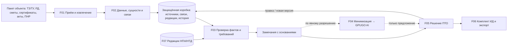

# Функциональная архитектура Construction Docs SaaS — версия 1.0

> Цель документа — **ответить, как система работает**, а не перечислить технологии. Основа — пользовательская схема защищённой «коробки» и изученные реестры, рабочая документация и комплекты электромонтажа/ПНР кейса ЧГЭС. Все примеры сущностей здесь синтетические. Закрытые оригиналы не переносятся в GitHub.

## С чего начать

**[Актуальная A0: изолированная коробка + ИИ + шлюз + нормативы (2 листа)](../../diagrams/10-A0-protected-box-functional.drawio)** · [зафиксированные решения и расхождения с текущим кодом](00-A0-protected-box.md). Остальные функции F01–F07 подлежат уточнению в соответствии с A0.

**[Открыть функциональную блок-схему в draw.io — 9 страниц](../../diagrams/09-functional-architecture.drawio)**

Схема включает:
- **A0 — общий цикл** от входящего пакета до комплекта ИД;
- **F01 — загрузка и извлечение**: поддерживаемые форматы, сканы, ошибки;
- **F02 — нормализация и связывание**: «документ → утверждение → работа/оборудование → доказательство»;
- **F03 — автоматический контроль**: правила, применимые нормативы, причины замечаний;
- **F04 — вызов AI на GPUGO**: какой payload проходит шлюз, как защищается, обрабатывается и возвращается;
- **F05 — решения ПТО**: подтверждение/отклонение/запрос данных, пересмотр документа;
- **F06 — комплектование и выдача ИД**: сведение реестра, формы, журнал, экспорт;
- **F07 — нормативный контур**: обновления НПА/НТД и безопасное применение редакций;
- **CASE — сквозная проверка**: условный пример кабельной трассы из класса документов ЧГЭС.

**[Версия с отображением блок-схем прямо в GitHub](flowcharts.md)** — Mermaid, редактируемый текст, без mind map.

**[Подробная спецификация каждой функции](01-functional-specification.md)** — точные входы, операции, условия переходов, выходы и отказоустойчивость.

**[Что реализовано и что нужно написать](02-code-coverage.md)** — честная матрица по файлам кода, оставшимся модулям и очередности работ.

## Логика A0 — кратко

### Принцип
1. **Оригинал** не теряется и не переписывается ИИ.
2. **Сведения из РД**, **факт выполнения**, **данные сметы**, **правовая норма** и **гипотеза ИИ** — разные классы утверждений.
3. **Локальная «коробка»** хранит связи и версии; юридические действия выполняют уполномоченные люди.
4. Сервер GPUGO предоставляет inference. В текущем PoC туда уходят лишь **категории находок и числовые счётчики**, без текста РД, маркировок и имени объекта. Поэтому на данном этапе AI **не может** выполнять полноценный содержательный анализ чертежей; это последующая функция, требующая отдельно согласованного безопасного режима контекста.
5. Отсутствие документа в импортированной папке не значит, что его не существует в реальности: замечание = запрос на проверку.

## Легенда статуса реализации
- **РЕАЛИЗОВАНО В POC** — код написан, но не обязательно проверен на реальном объекте и не готов к промышленной эксплуатации.
- **ЧАСТИЧНО** — часть последовательности реализована, важные бизнес-операции отсутствуют.
- **ПРОЕКТИРУЕТСЯ** — есть функциональные требования и схема, но нет рабочего модуля.

Это структура **настольного продукта для Windows**, а не мобильная карта экранов. В перспективах возможна серверная БД в периметре заказчика для нескольких ПТО, но исходные данные не предполагается переносить в GPUgo.
