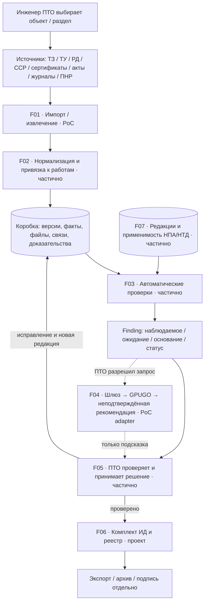
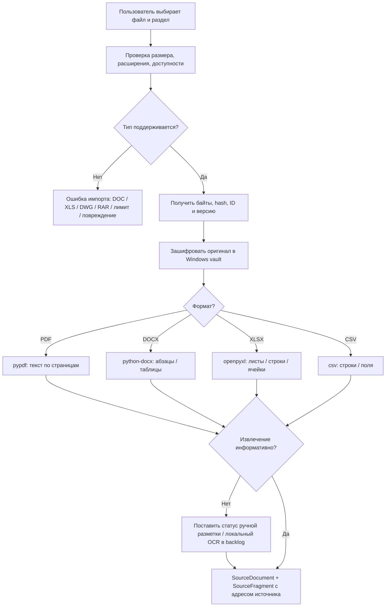
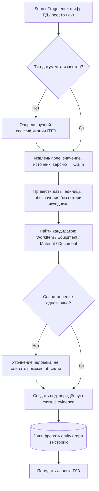
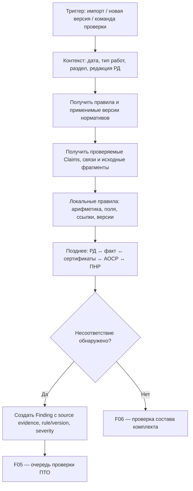
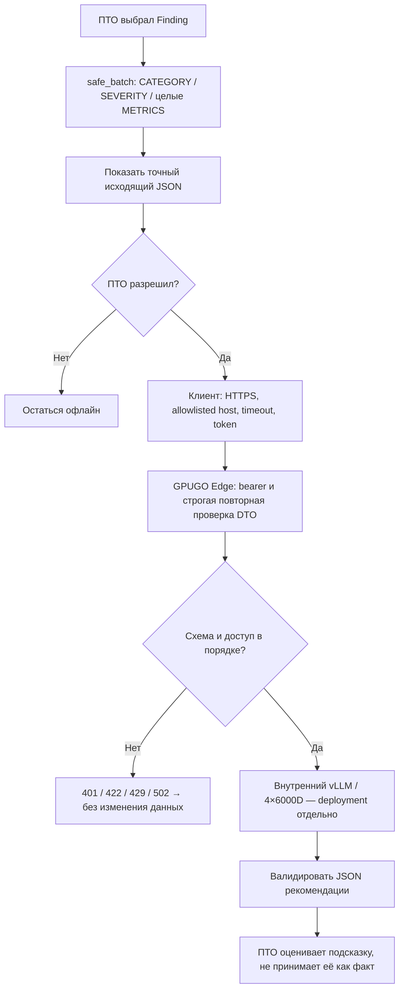
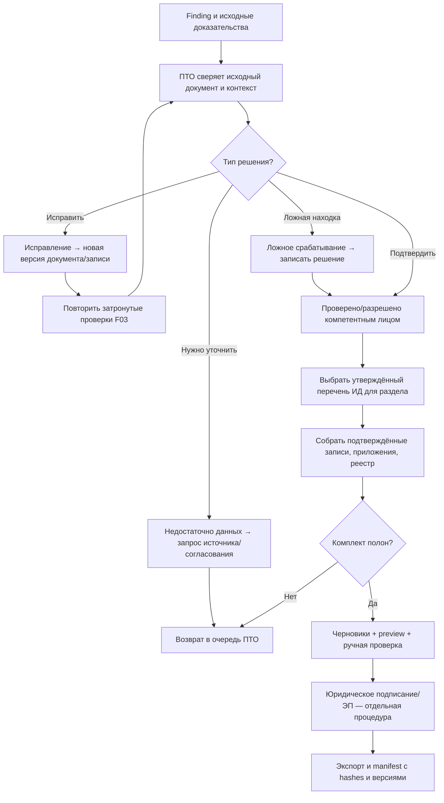
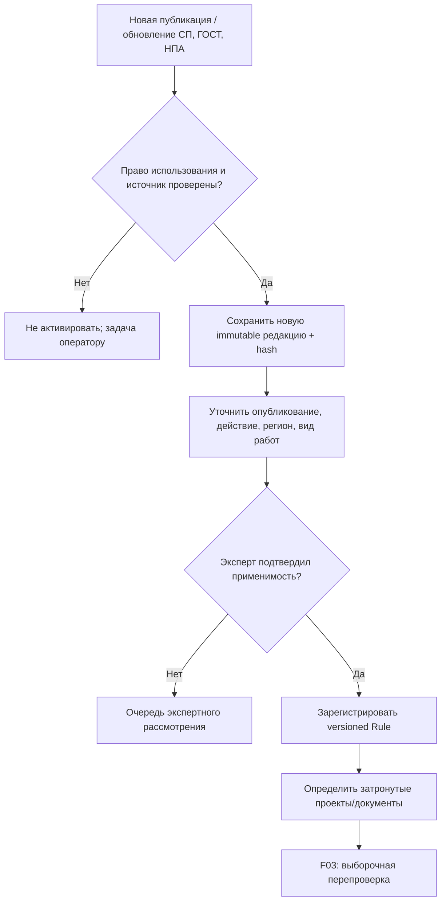
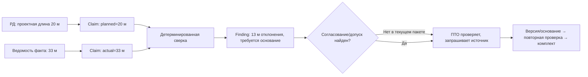

# Функциональные блок-схемы для просмотра прямо на GitHub

Эти схемы отображаются прямо в Markdown, не требуют скачивания редактора и могут редактироваться Codex как обычный текст. **[Полная редактируемая версия draw.io, 9 листов](../../diagrams/09-functional-architecture.drawio)** дополнительно содержит статусы реализации, примечания и технические границы.

Легенда: **PoC** — код написан, **частично** — код не реализует всю функцию, **проект** — алгоритм планируется. Для подробностей блока Fxx см. [спецификацию](01-functional-specification.md).

## A0 — общий алгоритм

## F01 — приём и извлечение документов

Фактический код: `construction_docs/ingest.py`, `vault.py`. Фрагменты с адресом ячейки/страницы — целевой формат, **ещё не реализован полностью**.

## F02 — формирование связанной предметной модели

Сейчас `construction_docs/graph.py` реализует типы узлов, связи и путь по графу; автоматическое извлечение `Claim` ещё не написано.

## F03 — воспроизводимая проверка

Сейчас реально выполняются **четыре проверки реестра** (расхождение числа страниц, перекрытие, пустой путь, пустая графа направления на проверку). Остальные связи — целевая модель.

## F04 — клиентский шлюз и GPUGO

**Ключевой предел:** AI видит только числовые ошибки и категории. Для сравнения содержимого документов нужна новая безопасная политика передачи специально разрешённых атрибутов; сейчас такого доступа нет.

## F05 → F06 — принятие решения и выпуск комплекта

F05 частично работает как журнал решений, **F06 пока не написан**.

## F07 — изменения нормативов и перепроверка

## Синтетический пример: длина кабеля

Это иллюстрация логики, не утверждение о действительности конкретной документации ЧГЭС.
