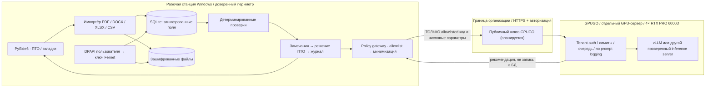
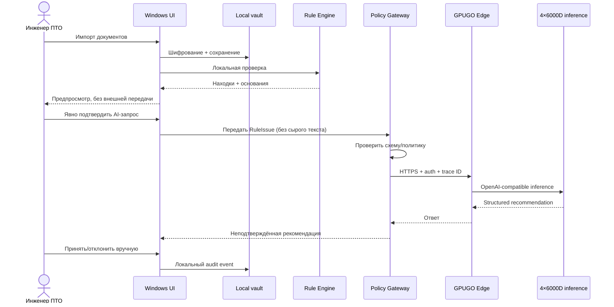

# Архитектура, границы доверия, эксплуатация

## Выбранная стартовая архитектура

Ни в один контейнер GPUGO **не должны** попадать исходные PDF, фотографии, схемы и полные записи из БД. Фраза «в зашифрованном виде для ИИ» не применима как метод анализа произвольного шифртекста. Здесь шифрование используется для хранения и TLS, а перед анализом — структурная минимизация.

## Разделение ролей компонентов

| Блок | Кому принадлежит | Хранит | Сеть |
| --- | --- | --- | --- |
| Windows UI + local core | Пользователь / организация | Доступ к закрытым данным, сессия ПТО | По умолчанию офлайн |
| Vault (SQLite/файлы) | Рабочая станция | Только ciphertext + DPAPI ключ | Не слушает входящих портов |
| Importer / Rule Engine | Рабочая станция | Обрабатывает документы в процессе | Сеть не нужна |
| Policy Gateway | Рабочая станция | Не хранит исходный prompt; проверяет outbound DTO | Только whitelisted HTTPS |
| GPUGO Edge | GPUGO | Короткоживущие задания, технические метрики | Интернет, authentication |
| Model Worker | GPUGO | Вес модели и KV cache; no disk prompt logging | Только внутренний API |
| Normative updater (будущий) | Контур заказчика | Редакции НПА/НТД + происхождение | Исходящие запросы к разрешённым источникам |

## Варианты развития
- **M0**: одна Windows-машина, локальный encrypted vault, один пользователь, локальные правила.
- **M1**: та же машина + GPUGO inference с минимизированными DTO, ручное подтверждение каждого запроса.
- **M2**: Windows UI + сервер в периметре заказчика: PostgreSQL, объектное шифрованное хранилище, RBAC, транзакции, ACL, журнал неизменяемых событий, очереди проверки. GPUGO только inference.
- **M3**: предприятие: tenant isolation, документы нескольких объектов, интеграции и ЭП по отдельному проектированию.

**Важно:** локальная версия не обеспечивает многопользовательские транзакции/права разных компаний; не называть её полноценным enterprise SaaS.

## Последовательность запросов

## Границы безопасности
1. GPUgo не знает соответствие локальных doc UUID и настоящих документов: шлюз заменяет локальные ID случайными ID запроса (в коде уходит только порядковый индекс).
2. Не отдавать LLM имя объекта, координаты, имена подрядчиков, ОГРН/ИНН/ФИО, заводские номера, чертежи, уставки РЗА и конфигурации.
3. Не позволять UI обходить policy gateway и дергать vLLM напрямую: production gateway должен проверять на сервере claim роли и quota, а не доверять заголовкам Windows клиента.
4. Никаких неподтверждённых исправлений исходных файлов; операции по подтверждению — отдельный audit trail.
5. Для будущего командного режима нужны аутентификация, авторизация по объектам, шифрованные бэкапы, выделенная сеть и административные процессы.

## Диаграммы
- [Большая mindmap](../../diagrams/03-development-mindmap.md)
- [ER модель](../../diagrams/04-domain-erd.md)
- [Deployment 4×6000D](../../diagrams/05-gpugo-deployment.md)
- [Windows UX](../../diagrams/06-windows-user-flows.md)
