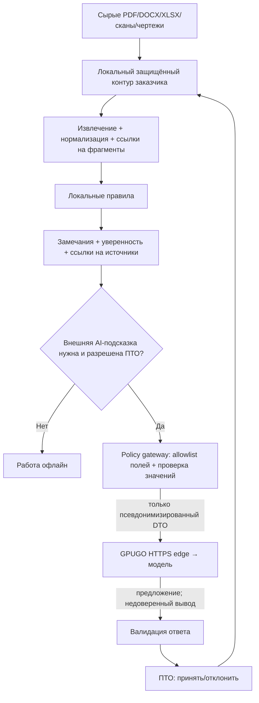

# Угрозы, криптография, шлюзы и data flow

## Неприкосновенная граница

## Четыре разных понятия
- **Шифрование at rest:** raw blobs и зашифрованные поля в SQLite; ключ Fernet под Windows DPAPI.
- **Шифрование в канале:** HTTPS/TLS к GPUGO; никакого HTTP в релизной конфигурации.
- **Псевдонимизация:** скрытие прямых идентификаторов до передачи AI; обратная таблица только локально.
- **Минимизация:** более строгий PoC-подход — вообще не отправлять текст документа и имена; передавать только тип несоответствия, numeric metrics и допустимые enum. Самый безопасный режим по умолчанию — AI выключен.

**Не писать в документации, что модель умеет анализировать криптографически зашифрованный произвольный документ.**

## Угрозы и меры
| Угроза | Мера | Остаточный риск |
| --- | --- | --- |
| Prompt injection из РД/PDF | Документы — данные, не инструкции, вход в LLM только через типизированный шлюз | Модель может неверно интерпретировать даже чистый DTO |
| Re-identification по маркировкам / редкой спецификации | В PoC нет текста и маркировок в outbound; только enum/числа | Сочетание редких чисел может быть идентифицирующим |
| Компрометация локального Windows | DPAPI, NTFS ACL, BitLocker, EDR, hardening | Администратор/вредонос в пользовательской сессии может читать открытые данные |
| Утечка через telemetry/logs | Не логировать prompt, оригиналы и ответы; минимальные event-id | Нужен аудит внешнего шлюза |
| Replay чужой операции | Срок жизни токена, nonce, подписи/временные метки на Edge | В PoC нет production auth |
| SSRF/подмена endpoint | Настраиваемый HTTPS endpoint, production allowlist доменов/пинов после ротации и инфраструктурных решений | URL конфигурация контролируется оператором PoC |
| Выполнение кода через RAR/DOC | RAR и DOC в PoC не распаковывать; парсить поддерживаемые форматы без shell | Возможные CVE парсеров |
| OCR видит коммерческие тайны | Запуск только в доверенном контуре с разрешениями | OCR в PoC не реализован |
| Ошибки нормативов | edition/status/effective period, экспертная проверка | Сложное право применения зависит от контекста |
| Подмена AI ответа | Строгая схема, не разрешать прямой записи и запуска команд | Социальная инженерия через текст рекомендации |

## Текущая security-планка кода
- Прототип шифрует чувствительные записи и blobs через Fernet; ключ шифруется Windows DPAPI. Это не решение для enterprise multi-tenant без доп. мер.
- У шлюза одна структура входа: `RuleIssue` с фиксированной категорией и необязательными целыми метриками. Предметные имена, номера договоров, ФИО, страницы самих документов, свободный текст исключены.
- Удалённый inference должен ответить JSON с краткими рекомендациями; затем обязательна валидация схемы. Любая ошибка отклоняет ответ.
- TLS и timeout обязательны; API-key в переменной окружения для разработческого PoC. Для production: broker короткоживущих tokens, отдельный tenancy gateway, аудит доступа, mTLS/VPN при необходимости.

## Hardening до реальных документов
1. Правовые основания обработки и договор между заказчиком и GPUGO, классификация данных, модель угроз, локализация/152-ФЗ и при необходимости требования отраслевых регуляторов.
2. Закрытый контур клиента или политика безопасного рабочего места; tamper-resistant event log, ключевой escrow, бэкап и ротация ключей.
3. Взаимная проверка service identity; периметровая сегментация GPU-worker и no prompt persistence.
4. App signing + CI supply-chain; сканирование зависимостей, code review, threat modeling STRIDE, pentest.
5. Для парсеров: лимиты на размер, страницы, распаковку ZIP, документы с макросами, rate limits и изоляция процесса.
6. Формальная red-team проверка утечек: номера/ФИО, скрытые PDF слои, метаданные DOCX, инженерные индексы.
