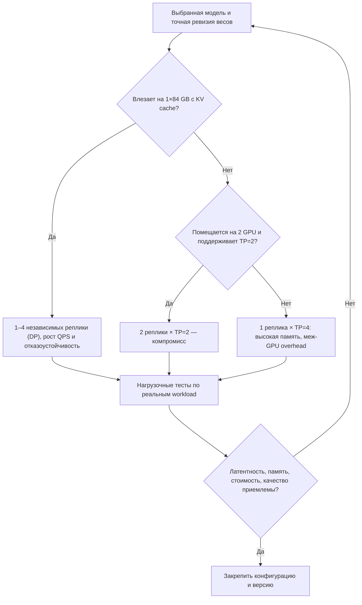

# GPUGO inference: 4 × RTX PRO 6000D Blackwell

## Важно про конкретную карту
Ориентир для **RTX PRO 6000D Blackwell Server Edition** — **84 GB GDDR7** на карту, 4 карты = 336 GB суммарной VRAM. Не путать с RTX PRO 6000 **без D** (96 GB). Указание HPE: https://www.hpe.com/psnow/downloadDoc/NVIDIA%20Accelerators%20for%20HPE%20QuickSpecs-c04123180.pdf?contentDisposition=attachment&form=false&hf=regular&id=c04123180.pdf&isFutureVersion=true&isLinearized=false&preview=false&ver=79

Фактическую модель/part number, PCIe-топологию, ECC, ограничения поставки, драйверы, версии CUDA, охлаждение, мощность PSU и сетевые порты проверить **после получения машины**. На GPU память расходуется не только на веса, но и на KV cache, активации, фрагментацию и коммуникации; 336 GB не означает, что все веса, даже 300 GB, гарантированно разместятся.

## Что поставить
- **Model API worker:** vLLM OpenAI-compatible endpoint, Linux+NVIDIA driver, за внутренним reverse proxy.
- **Edge gateway GPUGO:** отдельный HTTPS сервис с проверкой короткоживущего ключа/tenant, ограничениями размера, частоты запросов, budget и очереди, структурной валидацией. Не публиковать vLLM порт наружу.
- **Scheduler:** на старте один модельный пул; позже очередь заданий и приоритеты. Документы заказчиков **не складировать**.
- **Telemetry:** GPU util, VRAM, KV utilization, TTFT, tok/s, p50/p95, 429, 5xx, queue wait, отсутствие prompts в логах.
- **Secrets:** environment в защищённом хранилище, не в Git.

## Как решать расклад 4 GPU



Пример команды **только после проверки поддержки модели/квантования**:
```bash
# НЕ production-команда и НЕ рекомендация запускать любой MODEL на 4 GPU.
CUDA_VISIBLE_DEVICES=0,1,2,3 vllm serve /models/<approved-model> \
  --tensor-parallel-size 4 \
  --served-model-name construction-analyzer \
  --max-model-len 8192 \
  --gpu-memory-utilization 0.85 \
  --host 127.0.0.1 \
  --port 8000
```
По документации vLLM tensor-parallel доступен для multi-GPU: https://docs.vllm.ai/en/stable/serving/parallelism_scaling/

## Модель — не зафиксирована
Кандидаты: модель семейств Qwen/GLM/MiniMax с лицензией, поддерживающей коммерческую эксплуатацию; точная версия после тестирования на русском строительном корпусе. Перед выбором проверить наличие весов, право использования, vLLM поддержку, FP8/BF16/квантование, maximum context, structured outputs, способность давать ссылки на доказательства, hallucination rate. Не ориентироваться только на demo-tok/s.

## Профиль испытаний
- Нагрузки: 1/4/8/16 одновременных запросов, короткий/средний/длинный контекст, input ~0.5/2/8k tokens, output 128/512/1024 tokens.
- Измерять TTFT p50/p95, output tok/s на пользователя, суммарный TPS, очередь, VRAM peak, отказоустойчивость, таймауты, расходы.
- Качество: false positive, missed issue, evidence attribution, hallucinated citations, leakage after pseudonymization.
- Пределы запросов в MVP: max 10 findings, max 128/512 output tokens, timeout 30s; пересмотреть по benchmark.
- При timeout/5xx: только локальная работа, без ретраев содержащих более широкие исходные сведения.

## План безопасности edge
Сервис GPUGO должен иметь `/healthz`, `/v1/chat/completions` только для доверенного API-пользователя, client auth, token rotation, quota, ingress limits, JSON-logging без payload, отключённую запись промптов, сегментацию контейнеров и policies хранения; это **не реализовано** в текущем PoC и отдельно запланировано.

## Оценка ресурсов проекта
4×6000D — капитальный hardware resource, но PoC по обезличенным кодам замечаний не требует использования всех четырёх GPU. Сначала обосновать нагрузку и качество одной моделью/репликой; полный парк имеет смысл при мультиарендном inference и реальных данных. Не закреплять 4 GPU за этим продуктом без бюджетирования GPUGO.
