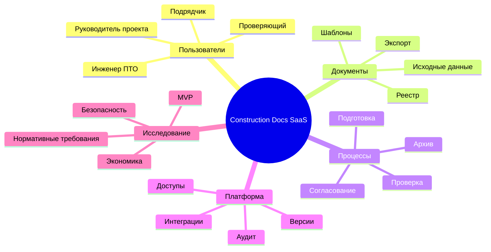

# Карта продукта — рабочие гипотезы

Цель: сократить ручной труд при подготовке, проверке и согласовании исполнительной документации на строительных объектах.

## Потенциальные пользователи
- Инженер ПТО — собирает и оформляет документы.
- Руководитель проекта — отслеживает комплектность и сроки.
- Подрядчик / субподрядчик — предоставляет исходные данные.
- Проверяющий — проверяет комплект и возвращает замечания.

## Возможные функции (не утверждены)
- Реестр объектов, работ и документов.
- Загрузка шаблонов и исходных файлов.
- Формирование черновиков документов из структурированных данных.
- Проверка комплектности и согласованности реквизитов.
- История версий, замечаний и статусов.
- Экспорт в согласованные форматы.

## Что нужно выяснить
- Какие виды исполнительной документации входят в MVP?
- Кто заказчик и кто фактически оплачивает подписку?
- Какие нормативные требования и актуальные формы обязательны?
- Какие источники данных доступны (Excel, PDF, BIM, сметы, журналы)?
- Допустим ли AI при работе с конфиденциальной документацией?
- Нужны ли ЭП, интеграции с ЭДО и системами заказчиков?

