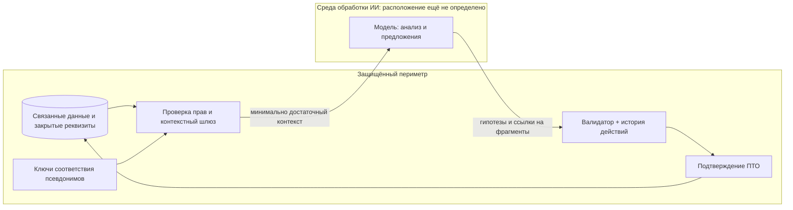

# Границы доверия и работа ИИ с конфиденциальной информацией

## Принцип

ИИ не получает неограниченный доступ к защищённой «коробке». Он получает только тот контекст, который нужен для конкретной проверки или предложения, через контролируемый шлюз. Прямые записи модели в доверенный реестр запрещены на концептуальном уровне.

## Важное техническое уточнение

**Шифрование не равно обезличиванию.** Обычная языковая модель не способна содержательно анализировать файл, если ей передать только криптографический шифртекст. Практический вариант — шифрование данных при хранении и передаче, плюс минимизация, маскирование или обратимая псевдонимизация перед контекстом модели; таблица обратного соответствия остаётся внутри защищённого периметра.

Даже псевдонимизированные строительные сведения могут косвенно идентифицировать объект, заказчика и участников. Поэтому необходим анализ угроз, разграничение доступа и запрет чувствительных данных в логах и промптах за пределами доверенного контура.

## Границы ответственности

- Источник данных: сохранять оригинал и его редакцию.
- AI: извлекать, сопоставлять, находить конфликты, предлагать.
- Детерминированная проверка: валидировать формат и допустимые операции над записями.
- ПТО / уполномоченные лица: подтверждать факты, корректировки, комплектность и подписание.
- Нормативный контур: получать обновления только из проверяемых источников с датой действия, областью применения и правом использования.

## Нерешённые технические вопросы

1. Что входит в доверенный периметр: только БД и шлюз или также локальная модель?
2. Откуда производится первоначальный импорт доверенных реквизитов, если «коробка принимает только ответы ИИ и обновления нормативов»?
3. Возможен ли безопасный экспорт фрагментов в стороннюю модель, либо допустим только локальный inference?
4. Как проверяются подлинность документа и юридическая значимость электронной подписи?
5. Как реализовать изоляцию проектов разных заказчиков (tenant isolation)?
